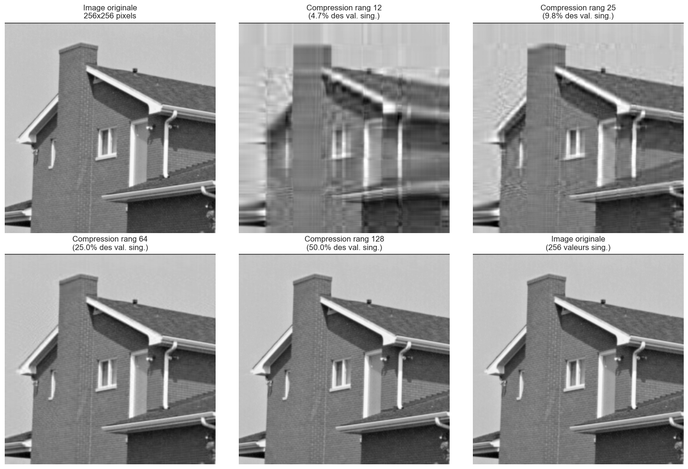
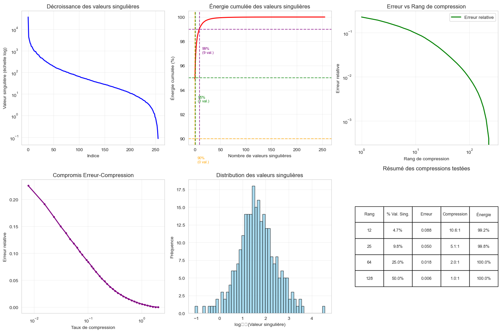
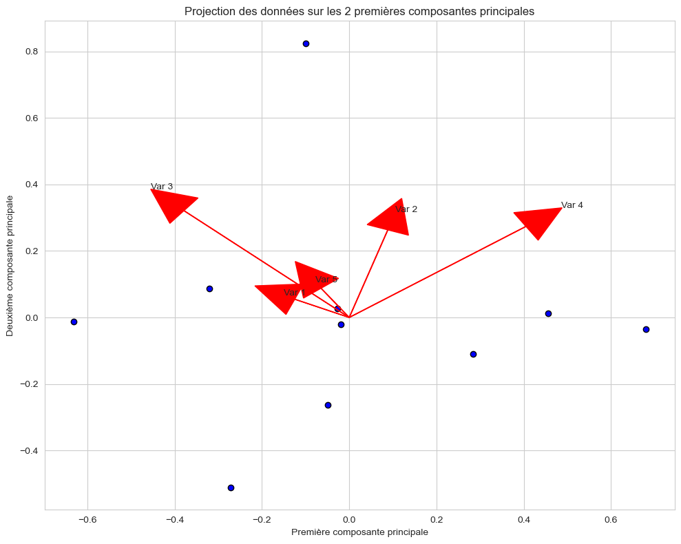
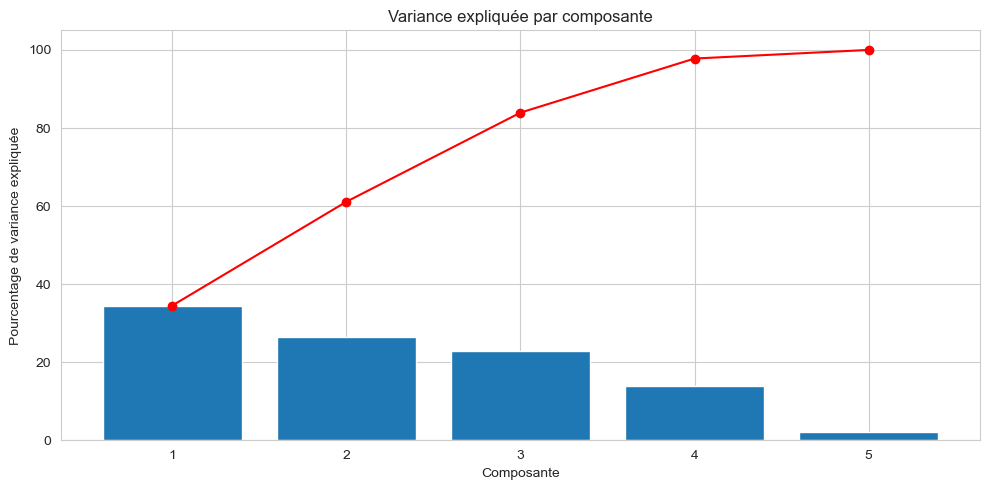

# 🧮 Numerical Linear Algebra for Data Science

[](https://www.python.org/)
[](https://numpy.org/)
[](https://scipy.org/)
[](https://jupyter.org/)
[](https://opensource.org/licenses/MIT)
[](https://ensat.ac.ma/)

A comprehensive computational and theoretical framework implementing fundamental numerical linear algebra methods in Python. This repository explores **direct and iterative linear solvers**, **fundamental matrix factorizations (LU, Cholesky, QR, SVD)**, and their core applications to **Principal Component Analysis (PCA)** and **low-rank SVD image compression**.

Includes full mathematical derivations, empirical benchmarks, and an exhaustive **37-page academic report** ([docs/Numerical_Linear_Algebra_Report.pdf](docs/Numerical_Linear_Algebra_Report.pdf)).

---

## 📑 Table of Contents

- [Overview](#-overview)
- [Key Features & Theoretical Foundations](#-key-features--theoretical-foundations)
  - [1. Linear System Solvers ($Ax = b$)](#1-linear-system-solvers-mathbfa-mathbfx--mathbfb)
  - [2. Matrix Factorizations (SVD & QR)](#2-matrix-factorizations-svd--qr)
  - [3. Principal Component Analysis (PCA) via SVD](#3-principal-component-analysis-pca-via-svd)
  - [4. Low-Rank SVD Image Compression](#4-low-rank-svd-image-compression)
- [Visual Gallery & Experimental Results](#-visual-gallery--experimental-results)
- [Empirical Benchmarks](#-empirical-benchmarks)
- [Repository Structure](#-repository-structure)
- [Getting Started & Reproduction](#-getting-started--reproduction)
- [Theoretical Report](#-theoretical-report)
- [Author & Acknowledgments](#-author--acknowledgments)
- [License](#-license)

---

## 📌 Overview

Numerical Linear Algebra is the computational backbone of modern Machine Learning, Data Science, and Computer Vision. Rather than treating linear algebra routines as black boxes, this project implements and analyzes algorithms from the ground up:

1. **Precision & Stability**: Evaluating machine epsilon limits, condition numbers, and numerical residuals across direct factorizations.
2. **Convergence Mechanics**: Comparing splitting methods (Jacobi vs. Gauss-Seidel) and proving how matrix spectral properties govern iterative convergence.
3. **Dimensionality Reduction**: Bridging Singular Value Decomposition (SVD) and covariance eigen-structures to formulate PCA from first principles.
4. **Data Compression**: Demonstrating the **Eckart–Young–Mirsky theorem** on 2D image matrices, evaluating energy retention thresholds ($90\%$, $95\%$, $99\%$) and rate-distortion trade-offs.

---

## 📐 Key Features & Theoretical Foundations

### 1. Linear System Solvers ($\mathbf{A} \mathbf{x} = \mathbf{b}$)

#### Direct Methods
* **LU Decomposition with Partial Pivoting ($\mathbf{P}\mathbf{A} = \mathbf{L}\mathbf{U}$)**: Factorizes general square non-singular matrices into lower ($\mathbf{L}$) and upper ($\mathbf{U}$) triangular matrices with permutation matrix $\mathbf{P}$. Solved via forward and backward substitution.
* **Cholesky Factorization ($\mathbf{A} = \mathbf{L}\mathbf{L}^T$)**: Exploits symmetry and positive-definiteness (SPD matrices). Requires half the floating-point operations ($O(\frac{1}{3}n^3)$ vs $O(\frac{2}{3}n^3)$) and guarantees numerical stability without pivoting.

#### Iterative Methods
Decomposing $\mathbf{A} = \mathbf{D} - \mathbf{E} - \mathbf{F}$ (diagonal, strictly lower, strictly upper parts):
* **Jacobi Method**:
  $$\mathbf{x}^{(k+1)} = \mathbf{D}^{-1} (\mathbf{E} + \mathbf{F}) \mathbf{x}^{(k)} + \mathbf{D}^{-1}\mathbf{b}$$
  Fully decoupled across coordinate dimensions, enabling trivial SIMD vectorization and parallelization.
* **Gauss-Seidel Method**:
  $$\mathbf{x}^{(k+1)} = (\mathbf{D} - \mathbf{E})^{-1} \mathbf{F} \mathbf{x}^{(k)} + (\mathbf{D} - \mathbf{E})^{-1}\mathbf{b}$$
  Incorporates updated coordinates within the same iteration, yielding faster convergence when the spectral radius $\rho(\mathbf{M}) < 1$.

---

### 2. Matrix Factorizations (SVD & QR)

* **Singular Value Decomposition (SVD)**:
  $$\mathbf{A} = \mathbf{U} \mathbf{\Sigma} \mathbf{V}^T$$
  Where $\mathbf{U} \in \mathbb{R}^{m \times m}$ and $\mathbf{V} \in \mathbb{R}^{n \times n}$ are orthogonal matrices containing the left and right singular vectors, and $\mathbf{\Sigma} = \text{diag}(\sigma_1, \dots, \sigma_r)$ with $\sigma_1 \ge \sigma_2 \ge \dots \ge 0$.
* **QR Factorization**:
  $$\mathbf{A} = \mathbf{Q} \mathbf{R}$$
  Decomposes $\mathbf{A}$ into an orthogonal matrix $\mathbf{Q}$ ($\mathbf{Q}^T\mathbf{Q} = \mathbf{I}$) and an upper triangular matrix $\mathbf{R}$, forming the foundation for orthogonal projections and least-squares regression.

---

### 3. Principal Component Analysis (PCA) via SVD

Rather than explicitly computing the costly sample covariance matrix $\mathbf{C} = \frac{1}{N-1}\mathbf{X}_c^T\mathbf{X}_c$, PCA is computed directly via thin SVD on mean-centered observations $\mathbf{X}_c$:

$$\mathbf{X}_c = \mathbf{U} \mathbf{\Sigma} \mathbf{V}^T \implies \mathbf{C} = \frac{1}{N-1}\mathbf{V}\mathbf{\Sigma}^2\mathbf{V}^T$$

* **Principal Directions**: Right singular vectors (columns of $\mathbf{V}$).
* **Principal Component Scores**: Projections onto the subspace: $\mathbf{Z} = \mathbf{X}_c \mathbf{V}_k$.
* **Explained Variance Ratio**: 
  $$\lambda_i = \frac{\sigma_i^2}{N-1}, \quad \text{EVR}_i = \frac{\lambda_i}{\sum_{j} \lambda_j} = \frac{\sigma_i^2}{\sum_j \sigma_j^2}$$

---

### 4. Low-Rank SVD Image Compression

According to the **Eckart–Young–Mirsky theorem**, the best rank-$k$ approximation $\mathbf{A}_k$ of a matrix $\mathbf{A}$ under both the Frobenius norm and spectral norm is obtained by truncating its SVD:

$$\mathbf{A}_k = \sum_{i=1}^{k} \sigma_i \mathbf{u}_i \mathbf{v}_i^T$$

* **Theoretical Approximation Error**:
  $$\|\mathbf{A} - \mathbf{A}_k\|_F = \sqrt{\sum_{i=k+1}^{\min(m, n)} \sigma_i^2}$$
* **Cumulative Energy**:
  $$E(k) = \frac{\sum_{i=1}^k \sigma_i^2}{\sum_{i=1}^{\min(m, n)} \sigma_i^2} \times 100\%$$
* **Storage Footprint**: Reduces storage from $m \times n$ values down to $k(m + n + 1)$.

---

## 📊 Visual Gallery & Experimental Results

### SVD Image Compression at Progressive Ranks
Comparison of low-rank approximations against the original $256 \times 256$ image:



---

### Compression Rate-Distortion & Energy Spectrum Analysis
Comprehensive 5-panel quantitative evaluation showing singular value decay, energy curves ($90\%, 95\%, 99\%$), error scaling, and distribution:



---

### PCA 2D Subspace Projection & Feature Biplot
Projected sample distribution along the first two principal components with variable contribution vectors:



---

### PCA Scree Plot & Cumulative Explained Variance
Explained variance per principal component alongside the cumulative variance trajectory:



---

## ⚡ Empirical Benchmarks

### 1. Direct Solvers Performance ($\mathbf{A} \mathbf{x} = \mathbf{b}$, SPD Matrix)
Both direct methods achieved machine-precision accuracy ($< 10^{-16}$ residual error), with Cholesky being computationally superior due to symmetry exploitation:

| Factorization | Residual Error ($\|\mathbf{A}\mathbf{x} - \mathbf{b}\|$) | Computational Complexity | Notes |
| :--- | :---: | :---: | :--- |
| **LU (Partial Pivoting)** | $5.55 \times 10^{-17}$ | $\approx \frac{2}{3}n^3$ flops | Robust general solver |
| **Cholesky ($\mathbf{L}\mathbf{L}^T$)** | $7.85 \times 10^{-17}$ | $\approx \frac{1}{3}n^3$ flops | $2\times$ faster on SPD matrices |

---

### 2. Iterative Solvers Convergence Comparison
Comparison on an $n=4$ linear system ($\text{tol} = 10^{-6}$, $\max\text{iter} = 100$):

| Method | Iterations | Runtime (s) | Residual Error | Status | Theoretical Reason |
| :--- | :---: | :---: | :---: | :---: | :--- |
| **Jacobi** | 100 | $1.51 \times 10^{-3}$ | $4.32 \times 10^{+27}$ | Diverged | Spectral radius $\rho(\mathbf{M}_J) \ge 1$ (not diagonally dominant) |
| **Gauss-Seidel** | **37** | **$5.08 \times 10^{-4}$** | **$5.98 \times 10^{-07}$** | **Converged** | In-place updates ensure $\rho(\mathbf{M}_{GS}) < 1$ |

---

### 3. SVD Image Compression Metrics ($256 \times 256$ Grayscale Image)

| Rank ($k$) | Singular Values Retained | Relative Error | Compression Ratio | Preserved Energy | Space Savings |
| :---: | :---: | :---: | :---: | :---: | :---: |
| **$k = 12$** | $4.7\%$ | $0.0878$ ($8.78\%$) | **$10.6 : 1$** | **$99.23\%$** | **$90.6\%$** |
| **$k = 25$** | $9.8\%$ | $0.0496$ ($4.96\%$) | **$5.1 : 1$** | **$99.75\%$** | **$80.4\%$** |
| **$k = 64$** | $25.0\%$ | $0.0180$ ($1.80\%$) | **$2.0 : 1$** | **$99.97\%$** | **$49.9\%$** |
| **$k = 128$** | $50.0\%$ | $0.0057$ ($0.57\%$) | **$1.0 : 1$** | **$100.00\%$** | $-0.2\%$ |
| **$k = 256$** | $100.0\%$ (Original) | $0.0000$ ($0.00\%$) | **$0.5 : 1$** | **$100.00\%$** | $-100.4\%$ |

> **Key Takeaway**: At just **$k = 12$** singular values ($<5\%$ of total spectrum), over **$99.2\%$ of the image energy** is preserved while reducing the raw footprint by **$90.6\%$**.

---

## 📂 Repository Structure

```text
numerical-linear-algebra-for-data-science/
├── assets/                                 # Exported high-resolution benchmark plots
│   ├── pca_explained_variance.png          # PCA Scree plot
│   ├── pca_projection_biplot.png           # 2D PCA biplot with eigenvectors
│   ├── singular_values_matrix.png          # Matrix D singular value spectrum
│   ├── svd_image_compression.png           # Rank-k reconstructed images grid
│   └── svd_metrics_analysis.png            # 5-panel SVD metrics analysis
├── docs/
│   └── Numerical_Linear_Algebra_Report.pdf # 37-page rigorous academic report
├── notebooks/
│   └── numerical_linear_algebra.ipynb      # Complete, reproducible Jupyter Notebook
├── .gitignore                              # Clean Python/Jupyter ignore rules
├── LICENSE                                 # MIT Open-Source License
├── README.md                               # Comprehensive project documentation
└── requirements.txt                        # Environment dependencies
```

---

## 🚀 Getting Started & Reproduction

### Prerequisites
* Python 3.9, 3.10, 3.11, or 3.12
* `git` and `pip` (or `conda` / `uv`)

### 1. Clone the repository
```bash
git clone https://github.com/yassiradila/Numerical-Linear-Algebra-For-Data-Science.git
cd Numerical-Linear-Algebra-For-Data-Science
```

### 2. Create and activate a virtual environment
```bash
# On Linux / macOS
python -m venv venv
source venv/bin/activate

# On Windows (PowerShell)
python -m venv venv
.\venv\Scripts\Activate.ps1
```

### 3. Install dependencies
```bash
pip install -r requirements.txt
```

### 4. Launch the Jupyter Notebook
```bash
jupyter notebook notebooks/numerical_linear_algebra.ipynb
```

---

## 📖 Theoretical Report

For an in-depth mathematical exploration, refer to the complete **37-page academic report**:
📄 **[docs/Numerical_Linear_Algebra_Report.pdf](docs/Numerical_Linear_Algebra_Report.pdf)**

Topics covered in the report include:
* Analytical proof of convergence criteria for Jacobi and Gauss-Seidel iterations.
* Derivation of the Frobenius norm optimality for Eckart–Young–Mirsky low-rank truncations.
* Detailed analysis of condition numbers and floating-point error propagation.
* Critical comparison of PCA linear dimensionality reduction vs. modern non-linear manifold learning.

---

## 👤 Author & Acknowledgments

* **Author**: [Yassir Adila](https://github.com/yassiradila)
* **Academic Program**: Master / Cycle d'Ingénieur in *Science des Données, Big Data et Intelligence Artificielle (SDBDIA)*
* **Department**: Intelligence Artificielle et Digitalisation (IAD)
* **Institution**: École Nationale des Sciences Appliquées de Tétouan (ENSA Tétouan), Université Abdelmalek Essaâdi
* **Academic Supervisor**: M. Adel Louly

---

## 📄 License

This project is licensed under the terms of the [MIT License](LICENSE). Feel free to use, modify, and reference this code in your own research and projects.
